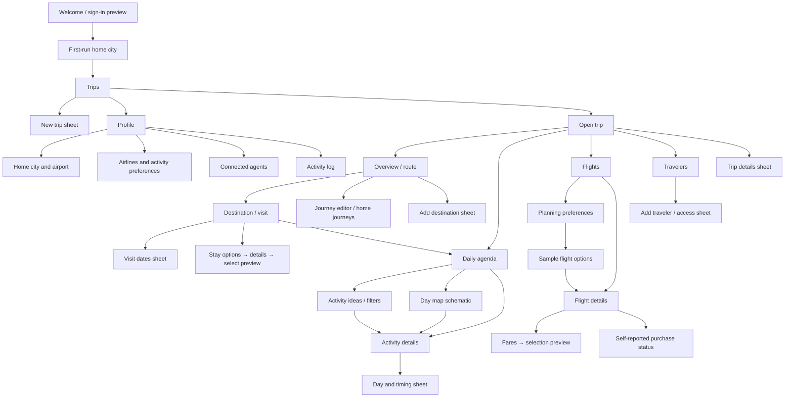

# Milestone 6: Native iOS application

## Current implementation update

The native app now opens on Trips without sign-in. Trip metadata is persisted with
SwiftData (CloudKit disabled), and local trips remain editable offline. Signing in
does not upload local trips; each trip offers an explicit, one-way Move to cloud.
Cloud metadata uses account-scoped cached values and separate durable pending edits.
Ordinary edits display optimistically, serialize writes per trip, and preserve
drafts on conflicts. Unknown write outcomes are reconciled before replay; cloud
editing is disabled when offline. Sign-out clears normal cloud caches but retains
unresolved operation journals for recovery with the same account.

Promotion uses PUT/GET `/trips/{tripId}/snapshot` and the existing v1 document schema.
This initial importer supports the native metadata feature set only; destination,
activity, reservation, Calendar, and Siri implementation remains pending. The
storyboard description below records the broader design, not completed native features.

Core persistence/recovery tests run with `swift test` from `src/TripPlanner.iOS`.
Every native view preview includes an isolated state-control sidebar.

Milestone 6 has two phases:

1. **Design:** storyboard the experience inside the existing iOS project, using
   navigable scenes and fictional content. This is the current phase.
2. **Implementation:** connect the agreed design to authentication, the API,
   device storage, maps, and planning services. This phase has not started.

## Reviewing the storyboard

Open `src/TripPlanner.iOS/TripPlanner.iOS.xcodeproj`, choose the `TripPlanner.iOS`
scheme and an iPhone simulator, then press Cmd-R. The project retains its existing
iOS 27.0 minimum. Start with a smaller iPhone; iPad is supported with a centered,
bounded content column, but this phase prioritizes the phone experience.

The app starts on Trips so reviews can reach the core experience immediately.
The top-left Storyboard button opens a review-only scene index. Welcome and
first-run setup are available there. The top-right button opens Profile.
The index is a design tool and is not proposed as part of the production app.

All names, dates, prices, schedules, history, account details, and permissions are
presentation fixtures. No network, authentication, database, persistent settings,
downloads, provider search, external app opening, invitation sending, or booking
is implemented. Navigation, filtering/sorting, and temporary form controls are
the only interactive behavior. Save/select/search/recovery actions explain the
phase boundary; they do not report a successful operation. Dismissing a form
discards its temporary draft. Restarting the app restores the same fixtures.

## From Interface Builder to SwiftUI

The existing project was already a SwiftUI app. It stays in Swift, without
Objective-C or an Interface Builder storyboard. Views declare their layout in
Swift; `#Preview` declarations show named scenes in Xcode’s live Canvas.

| Familiar storyboard concept | Equivalent used here |
| --- | --- |
| Scene / view controller | A SwiftUI `View`, named `…Scene` |
| Push segue | `NavigationLink` inside a `NavigationStack` |
| Modal presentation | `.sheet`, with its own navigation title and Cancel |
| Tab bar controller | `TabView` for the four sections of an open trip |
| Outlets / draft form values | Local `@State` values |
| Interface Builder preview | Named `#Preview` in Editor → Canvas |

The Canvas previews include offline, skeletons, save errors, dark appearance, and
larger text. Run the simulator for end-to-end navigation. Apple documents the
[SwiftUI preview workflow](https://developer.apple.com/documentation/swiftui/previews-in-xcode).

## Screen map



The trip’s bottom tabs stay scoped to that trip. Back returns to the previous
screen; Cancel closes a grouped edit. Overview calls attention to unfinished
stays. Completed choices use neutral status pills. No separate global tab bar
competes with the trip tabs.

## Suggested review paths

1. **Build the route:** Trips → Japan in spring → Tokyo → Edit visit dates.
   Cancel, then explore the selected stay. Back on Overview, inspect the Kyoto
   stay prompt, Add destination, and each connecting journey.
2. **Plan a day:** Agenda → choose a destination and date → activity details →
   Edit day & timing. Other dates show an unscheduled-day empty state. Explore
   saved activities, filter/sort them, and open the day map schematic.
3. **Choose flights:** Flights → an unselected journey → planning preferences →
   sample results → flight details → fares → Select fare. Compare that path with
   the already-selected outbound flight and its purchase-status sheet.
4. **Collaborate:** Travelers → Add traveler. Review access levels, then cancel.
   Profile contains home base, preferences, connected agents, and history.
5. **Offline:** Storyboard → Offline · Full walkthrough. Use the same tabs,
   dates, filters, lists, and detail views. Editing and network-dependent actions
   are disabled. A saved-copy banner explains the state. The fixture is not an
   actual downloaded snapshot.
6. **Recovery:** Storyboard → Loading, empty & load errors, and switch between
   Trips and Agenda. Separate Saving, Save failed, and Changed elsewhere entries
   show the trip editor with an unsaved draft. The conflict includes the previous
   confirmed name for comparison. Retry/Refresh are explanatory controls only.

The map scene currently storyboards stop order and access to saved details. It
is explicitly schematic: there are no geographic tiles, directions, or distances.
Real map layout and provider behavior remain work for phase 2. Flight options
are explicitly fictional and unverified; unknown baggage and onboard details
are not filled with invented facts.

## Interaction decisions for phase 2

- Keep edits to related values in a draft: trip metadata, visit dates, journey
  details, home city/airport, and activity day/time/duration use explicit
  Save/Apply. Preserve drafts on save failure or concurrency conflicts.
- Save independent selections immediately: stay/fare choice, activity selection,
  purchase flag, and airline additions/removals. Independent free text saves on
  blur after local validation, with saving/error status and retry.
- Preserve visible confirmed content while saving, serialize resource writes,
  and use complete-resource updates and validators from milestone 5. A refresh
  failure after a committed save must not become a repeated mutation.
- Offline uses the same navigation and layouts with read-only cached content.
  Viewing, filtering, sorting, and scrolling remain available. Real offline
  storage, session revalidation, and cache removal on sign-out are phase 2 work.
- Use feature-specific skeletons for initial loading. Trips and Agenda have
  separate skeleton compositions here. Short saves retain the form with status
  text and disabled controls. There are no simulated delays or spinners.
- A stay selection is not a reservation; a flight selection is not a purchase.
  A purchase flag is self-reported. Access roles shown here are illustrative;
  server authorization will govern real edits and party management.

Before implementation, review the four-tab structure, the agenda/idea boundary,
flight comparison depth, and the schematic map interaction. This prototype is a
starting design, not evidence that every web editing capability has native parity.
Native system-browser OAuth + PKCE, secure credentials, milestone 5 snapshots,
cache lifecycle, real resource validation, search jobs and progress, geographic
maps, accessibility auditing, and automation belong to phase 2.

## Source guide and reproducible previews

All prototype scenes live under `src/TripPlanner.iOS/TripPlanner.iOS/Storyboard`.

| File | Responsibility |
| --- | --- |
| `ContentView.swift` (parent directory) | Entry point and debug-only review shortcuts |
| `StoryboardIndex.swift` | Scene index and selectable read-state review |
| `StoryboardKit.swift` | Presentation styles, cards, state banners, skeletons, action explanations |
| `SampleTrip.swift` | Immutable presentation fixtures and route illustration |
| `TripsScenes.swift` | Trips, trip tabs, overview, metadata sheet |
| `DestinationScenes.swift` | Visits, stays, visit dates, and journeys |
| `ActivityScenes.swift` | Agenda, activities, details, timing sheet, map schematic |
| `FlightScenes.swift` | Flight planning, comparisons, details, fares, purchase flag |
| `AccountScenes.swift` | Welcome, onboarding, travelers, profile and preferences |

For repeatable screenshots, Debug builds accept these optional Xcode scheme
arguments (Product → Scheme → Edit Scheme → Run → Arguments):

```text
--review-scene agenda
--review-state Offline
--review-dark
--review-large-text
```

Scene values: `trips` (default), `index`, `welcome`, `trip`, `agenda`, `activities`,
`flights`, `travelers`, `stays`, `profile`, `map`, and `editor`. State values match
their labels: `Ready`, `Loading`, `Empty`, `Offline`, `Load failed`, `Saving`,
`Save failed`, and `Changed elsewhere`. Loading/empty/load-error layouts are
defined for Trips and Agenda; edit-state examples use `editor`. These arguments
are ignored in Release builds. Normally no arguments are needed.
